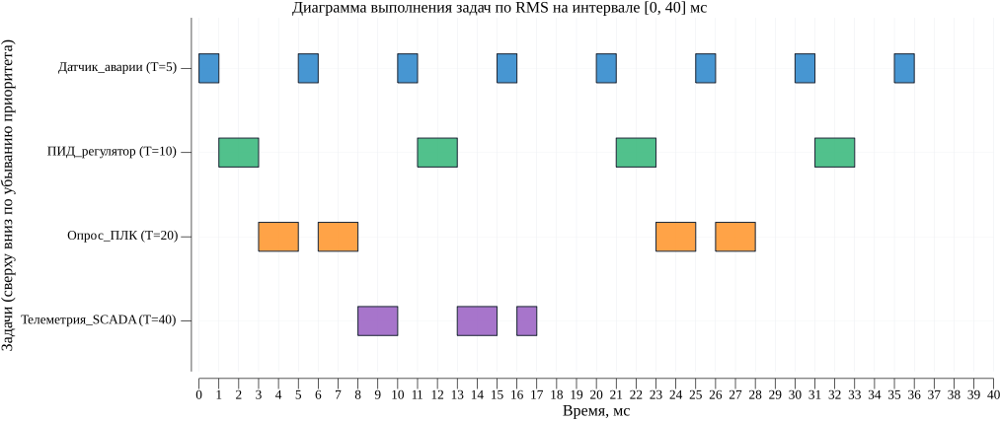

# Анализ планируемости задач реального времени (RMS и EDF)

Консольное приложение на языке Go для анализа планируемости набора периодических задач реального времени $\tau_i = (C_i, T_i, D_i)$ методами **Rate Monotonic Scheduling (RMS)** и **Earliest Deadline First (EDF)**, вычисления времени отклика $R_i$ каждого процесса и визуализации временно́й диаграммы выполнения (диаграммы Ганта).

---

## Запуск
### Предварительные требования
* Установленная среда разработки Go (версия 1.27.0 или новее).
* Установка зависимостей проекта для построения графиков.
### Выполнение программы
Запуск выполняется из корневого каталога репозитория:
```bash
go mod tidy
go run ./src/main.go
```
При запуске программа прочитает задачи из файла `data/tasks.csv`, выполнит расчёты и сформирует изображение графической диаграммы по пути `src/charts/chart.png`.

---

## Вариант: узел АСУ ТП

Входной набор содержит 4 периодические задачи узла АСУ ТП (значения времени приведены в миллисекундах):

| Задача | $C_i$ (мс) | $T_i$ (мс) | $D_i$ (мс) |
| :--- | :---: | :---: | :---: |
| `Датчик_аварии` | 1 | 5 | 5 |
| `ПИД_регулятор` | 2 | 10 | 10 |
| `Опрос_ПЛК` | 4 | 20 | 20 |
| `Телеметрия_SCADA` | 5 | 40 | 40 |

### Результат выполнения

#### Вывод из консоли

```text
Входной файл: data\tasks.csv (количество задач n = 4)
Задача            C      T       D       R       Уложилась
------            -----  ------  ------  ------  ------
Датчик_аварии     1      5       5       1       Да
ПИД_регулятор     2      10      10      3       Да
Опрос_ПЛК         4      20      20      8       Да
Телеметрия_SCADA  5      40      40      17      Да

--- ЗАКЛЮЧЕНИЕ ---
Коэффициент загрузки: U = 0.725
RMS (граница Liu & Layland для n = 4 равна 0.757): тест выполнен (U <= границы) — набор планируем.
EDF: U = 0.725 (U <= 1 — набор планируем).
Гиперпериод: H = 40 мс. Диаграмма выполнения RMS сохранена в ./src/charts/chart.png
```

#### Диаграмма выполнения



---

## Формат входных файлов

Набор задач считывается из файла `data/tasks.csv`. 

### Структура `tasks.csv`
Файл содержит заголовки столбцов и параметры задач, разделённые запятой:

```csv
Name,C,T,D
Датчик_аварии,1,5,5
ПИД_регулятор,2,10,10
Опрос_ПЛК,4,20,20
Телеметрия_SCADA,5,40,40
```

#### Описание параметров:
* `Name` — уникальное название периодической задачи;
* `C` — наихудшее время выполнения задачи (WCET) в мс;
* `T` — период поступления задачи в мс;
* `D` — относительный дедлайн задачи в мс.

---

## Методы

В программе реализованы следующие ключевые функции и расчетные методы:

### 1. `utilization(tasks []Task) float64`
Вычисляет суммарный коэффициент загрузки процессора $U$:
$$U = \sum_{i=1}^{n} \frac{C_i}{T_i}$$
где $n$ — число задач в системе, $C_i$ — время выполнения, $T_i$ — период задачи $\tau_i$.

### 2. `liu_layland_bound(n int) float64`
Вычисляет верхнюю границу достаточного теста планируемости Liu & Layland для $n$ задач под управлением RMS:
$$U_{LL}(n) = n \cdot \left(2^{1/n} - 1\right)$$

### 3. `rms_schedulable(tasks []Task) bool`
Определяет планируемость набора задач алгоритмом RMS:
1. Проверяет достаточное условие Liu & Layland: при $D_i = T_i$ и $U \le U_{LL}(n)$ набор гарантированно планируем.
2. Проводит точный анализ по времени отклика (RTA): при $U > U_{LL}(n)$ проверяется выполнение условия $R_i \le D_i$ для всех задач.

Приоритеты в RMS назначаются автоматически по правилу: меньший период $T_i$ соответствует более высокому приоритету.

### 4. `edf_schedulable(tasks []Task) bool`
Проверяет критерий планируемости алгоритма EDF для задач с неявными дедлайнами ($D_i = T_i$):
$$U \le 1$$

### 5. `response_time(task Task, higher []Task) int`
Рассчитывает время отклика $R_i$ задачи $\tau_i$ с учетом вытеснения более приоритетными задачами из множества $HP(i)$ по итерационной формуле:
$$R_i^{(k+1)} = C_i + \sum_{j \in HP(i)} \left\lceil \frac{R_i^{(k)}}{T_j} \right\rceil C_j$$
Итерации стартуют с $R_i^{(0)} = C_i$ и завершаются при $R_i^{(k+1)} = R_i^{(k)}$.

### 6. `gantt(tasks []Task, interval int) []ScheduleSegment`
Моделирует пошаговое выполнение процессов методом RMS на интервале $[0, H]$, где $H = \text{lcm}(T_1, T_2, \dots, T_n)$ — гиперпериод системы. Сохраняет графическую диаграмму по пути `./src/charts/chart.png`.

---

## Структура
* `go.mod` – Модуль Go и список зависимостей
* `data/tasks.csv` – Файл с входными данными
* `src/main.go` – Логика анализа планируемости и построения графиков
* `src/charts/chart.png` – Сохраненный график диаграммы выполнения